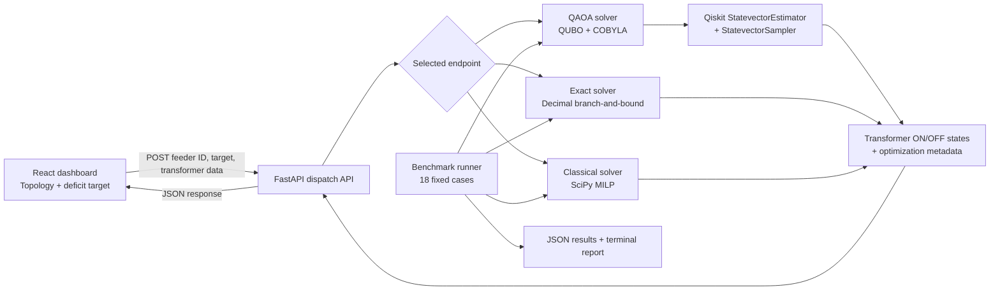

# Quantum Feeder Load-Shedding Project Report

**Evaluation date:** 13 November 2026  
**Scope:** The FastAPI dispatch service, QAOA solver, exact branch-and-bound solver, classical MILP solver, and the 18-case benchmark.

## Architecture



The dashboard sends the feeder, requested shed amount, and transformer attributes to one of three FastAPI routes. Each route calls its solver and returns a common transformer-state response. The benchmark invokes the solver functions directly with the same test cases and fairness inputs; it is not part of the frontend request flow.

## Benchmark results

The benchmark contains 18 cases: four small grids, six six-transformer feeder cases, four synthetic 8–10 transformer grids, two edge cases, and two supplemental historical-outage fairness cases. Eleven cases include outage counts. QAOA used one QAOA layer, COBYLA with a 60-iteration limit, 2,048 statevector samples, and seed 7. The objective is the project’s revenue-loss proxy (`load_kW × recovery_ratio`) plus a configured fairness penalty of 15 cost units per prior outage. These are model cost units, not verified dollars; no tariff or currency data is modeled.

| Solver | Mean runtime | Mean gap to Exact* | Feasible cases |
|---|---:|---:|---:|
| QAOA (Qiskit statevector primitives) | 0.524 s | 0.00% | 17/18 (94.4%) |
| Exact branch-and-bound | 0.00016 s | 0.00% | 17/18 (94.4%) |
| Classical MILP | 0.0082 s | 0.00%** | 17/18 (94.4%) |

\* The gap is based on fairness-adjusted objective cost and omits undefined zero-reference cases.  
\** On all target-achievable, positive-deficit cases, MILP matched the exact objective. The zero-deficit case exposed a classical solver state bug described below.

### Exact and classical reference comparison

For all 16 cases with a positive, achievable target, QAOA, MILP, and exact branch-and-bound returned feasible solutions with the same measured objective cost as the exact reference. In the over-capacity edge case, all three correctly kept the critical transformers on and shed the full 410 kW of available discretionary load; the requested 500 kW target was infeasible. Thus the 17/18 feasibility result reflects the intentionally impossible edge case, not a missed feasible target.

The zero-deficit case reveals a defect in `classical_solver.py`: it reports “no shedding required” in its metadata but returns every transformer OFF. QAOA and Exact both return every transformer ON, as required. The benchmark’s simple feasibility metric counts the classical zero-target result as feasible because it shed at least zero kW; feasibility alone therefore does not capture unnecessary shedding. Classical’s zero-target objective should not be treated as a valid match to Exact. This case should be fixed and the benchmark rerun before presenting classical equivalence as fully validated.

On these small instances, exact branch-and-bound is the fastest reference, followed by MILP, then QAOA. The measured QAOA runtime includes statevector primitive and optimizer overhead. Its approximately 0.52-second mean is about 64 times the MILP mean and 3,000 times the exact mean here. The test sizes are small enough that classical exact optimization is exceptionally cheap.

## Why QAOA is worth pursuing

The strongest evidence in this prototype is **solution quality**: with a fixed seed and the tested settings, QAOA found a feasible schedule matching the exact objective for every target-achievable case in the suite. It also represents the actual dispatch objective and deficit constraint as a QUBO/Ising problem, then uses the same parameterized circuit and sampling flow intended for Qiskit backends. That gives the project a meaningful hybrid quantum optimization path, rather than a decorative quantum label around a classical answer.

QAOA is also a useful research direction because its circuit can be mapped to quantum hardware and studied as grid size, constraints, fairness objectives, and circuit depth change. The benchmark establishes a baseline for that work: it shows where the current formulation succeeds, gives exact answers for comparison, and exposes runtime and edge-case behavior. The defensible claim today is that QAOA is a promising, functioning experimental solver with competitive solution quality on this test set—not that it is already faster or better than classical optimization.

## Limitations and next steps

- **No quantum advantage is demonstrated.** The benchmark used Qiskit’s `StatevectorEstimator` and `StatevectorSampler`, which simulate the circuit classically. No quantum hardware, hardware noise, queue time, or end-to-end remote execution was measured.
- **Small benchmark.** The largest case has 10 transformers. At this scale, exact search and MILP are natural references and solve quickly; results do not establish how QAOA compares on large, operational feeder networks.
- **One QAOA configuration.** Results use one layer, one optimizer restart, a fixed seed, and one sample budget. This is reproducible for the current setup but does not measure variation across seeds, circuit depths, restarts, or shot counts.
- **Penalty formulation and sampling.** QAOA uses a penalty-based QUBO and chooses among sampled feasible bitstrings. Penalty magnitude, slack encoding, and the chance of sampling a feasible candidate can affect quality; the implementation raises an error if no feasible sample appears.
- **Simplified economics and fairness.** `load_kW × recovery_ratio` is a proxy, not a monetary revenue model. Fairness uses a fixed penalty per historical outage, not a validated equity policy. The benchmark supplies histories directly; the API currently does not retain outage history.
- **Validation gap.** The classical zero-deficit state bug means its feasibility score overstates correctness for that edge case. Fix the early-return state initialization, then rerun the benchmark. More checks should cover critical-node protection, target infeasibility, missing/invalid input fields, and repeated runs.
- **Operational safety.** This is a prototype dispatch demonstrator. It has not been validated against protection engineering requirements, live grid telemetry, or utility operating procedures and should not directly control physical infrastructure.

## Reproducibility

Run the benchmark from the project environment with:

```bash
venv/bin/python benchmark_three_algorithms.py --output three_algorithm_evaluation_results.json
```

The script prints the case-by-case Markdown table and aggregate summary to the terminal, then writes the detailed inputs, states, timings, and solver metadata to `three_algorithm_evaluation_results.json`.
