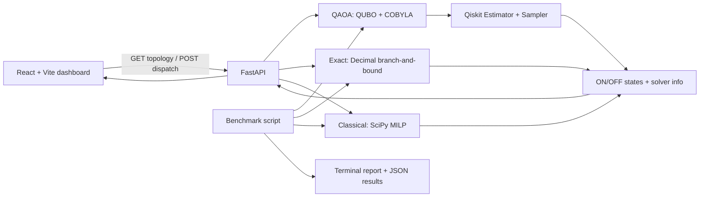

# Quantum Feeder Load-Shedding Dashboard

A full-stack prototype for visualizing a distribution feeder and comparing three load-shedding strategies: QAOA, exact branch-and-bound, and classical mixed-integer linear programming (MILP). The dashboard sends a requested shedding amount to a FastAPI service and displays the returned transformer ON/OFF schedule.

> This is a research and demonstration project. It is not connected to a live electrical grid and is not suitable for controlling physical infrastructure.

## Features

- Feeder topology display with nested lateral traversal and transformer status cards.
- Load-shedding control panel and a simulated feeder kill switch.
- Separate dispatch tabs for QAOA, exact, and classical MILP solvers.
- Critical transformer protection in the solver inputs.
- QAOA implemented with Qiskit primitives, COBYLA parameter optimization, and statevector sampling.
- An 18-case benchmark that prints a comparison table and saves detailed results as JSON.

## Architecture



The API exposes `GET /get_topology` and three dispatch routes:

| Algorithm | Endpoint | Implementation |
|---|---|---|
| Quantum | `POST /api/optimize-dispatch` | QUBO/Ising formulation, Qiskit `StatevectorEstimator` and `StatevectorSampler`, COBYLA |
| Exact | `POST /api/exact-dispatch` | Deterministic Decimal-based branch-and-bound |
| Classical | `POST /api/classical-dispatch` | SciPy MILP |

All dispatch routes accept `feeder_id`, `load_shedding_kw`, and a list of transformers (`id`, `load_kw`, `recovery_ratio`, `is_critical`). They return `transformer_states` and `optimization_info`. The API does not keep outage history between requests. The kill switch is a frontend simulation; it does not call an API route or operate equipment.

## Project layout

```text
.
├── endpoints.py                  # FastAPI routes and request/response models
├── main.py                       # Example nested feeder topology
├── quantum_solver.py             # QAOA-based dispatch
├── exact_algorithm.py            # Exact Decimal branch-and-bound solver
├── classical_solver.py           # SciPy MILP solver
├── benchmark_three_algorithms.py # 18-case benchmark runner
├── PROJECT_REPORT.md             # Benchmark results and limitations
├── requirements.txt              # Backend Python dependencies
└── QUANTAGRID/                   # React + Vite frontend
```

## Requirements

- Python 3.10 or newer
- Node.js and npm
- Qiskit, FastAPI, Uvicorn, NumPy, and SciPy

## Run locally

### 1. Set up the backend

From the project root:

```bash
python -m venv venv
source venv/bin/activate
python -m pip install --upgrade pip
pip install -r requirements.txt scipy
```

Start the API:

```bash
uvicorn endpoints:app --reload --host 127.0.0.1 --port 8000
```

The topology is available at [http://127.0.0.1:8000/get_topology](http://127.0.0.1:8000/get_topology). Interactive API documentation is at [http://127.0.0.1:8000/docs](http://127.0.0.1:8000/docs).

### 2. Set up the frontend

In another terminal:

```bash
cd QUANTAGRID
npm ci
npm run dev
```

Open the local URL printed by Vite (usually [http://localhost:5173](http://localhost:5173)). Vite proxies `/get_topology` and `/api` requests to the backend on port 8000.

## Run the benchmark

With the project Python environment active, run:

```bash
python benchmark_three_algorithms.py
```

The script runs 18 deterministic test configurations across small, standard, scaled, edge, and supplemental fairness cases. It prints a case-by-case Markdown table and aggregate summary, then writes `three_algorithm_evaluation_results.json` in the current directory. To customize its output path or QAOA budget:

```bash
python benchmark_three_algorithms.py \
  --output results/three_algorithm_evaluation_results.json \
  --qaoa-maxiter 60 \
  --qaoa-shots 2048 \
  --seed 7
```

The benchmark reports runtime, achieved shed load, a revenue-loss proxy, fairness-adjusted objective cost, gap against the exact result, and feasibility. The reported revenue-loss proxy is `load_kw × recovery_ratio`; it is not a dollar amount because the project has no tariff model.

## Notes on solver behavior

- Critical transformers are marked with `is_critical: true` and are kept ON by the solvers.
- The target is a minimum shed amount. A discrete transformer schedule can shed more than the target.
- If the target exceeds discretionary load, the solver can shed all discretionary load but cannot satisfy the requested target while protecting critical nodes.
- QAOA uses a fixed default random seed for repeatable local runs, but it is a sampling-based approximate method. Its output can depend on the QAOA settings and sampled candidates.
- Exact branch-and-bound is the deterministic reference for the included small benchmark instances.
- The benchmark uses Qiskit statevector primitives, which simulate quantum circuits on a classical computer. The current results do not demonstrate a quantum speedup or quantum hardware performance.
- The benchmark has identified a zero-deficit state initialization issue in `classical_solver.py`; see [PROJECT_REPORT.md](PROJECT_REPORT.md) before interpreting that edge-case result.

## Further reading

- [Project benchmark report](PROJECT_REPORT.md)
- [Detailed benchmark results](three_algorithm_evaluation_results.json)
